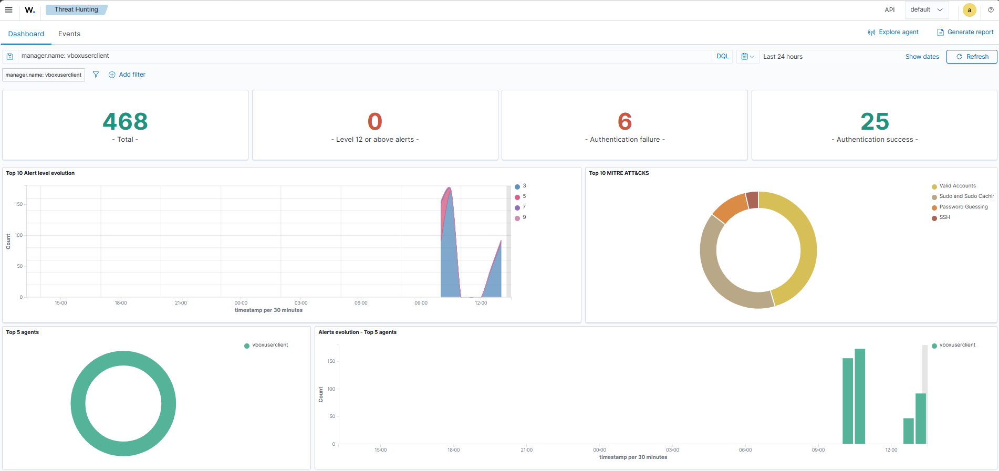
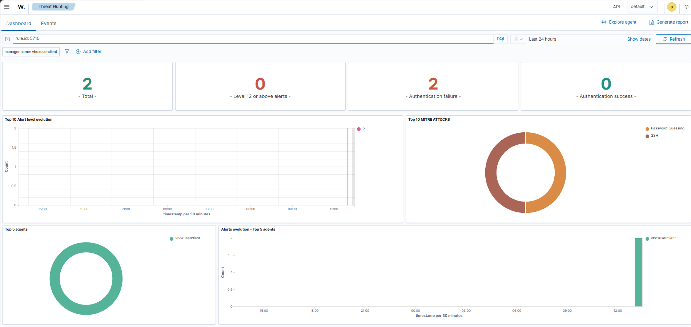

# Démonstration SOC : détection d'une tentative de connexion SSH échouée

## 1. Objectif

Pour cette première démonstration, je voulais vérifier que Wazuh était capable de détecter une tentative de connexion SSH échouée et de faire remonter les événements correspondants dans son tableau de bord.

J'ai choisi ce scénario parce que les échecs de connexion font partie des événements qu'un analyste SOC doit savoir repérer et analyser.

## 2. Environnement utilisé

J'ai réalisé ce test dans mon laboratoire de cybersécurité avec les éléments suivants :

- **Système :** Ubuntu Linux
- **SIEM :** Wazuh
- **Service testé :** OpenSSH
- **Utilisateur testé :** `utilisateur_test_inexistant`
- **Adresse source :** `127.0.0.1`

Le but était de provoquer volontairement un échec de connexion, puis de vérifier si cet événement apparaissait dans les journaux système et dans Wazuh.

## 3. Déroulement du test

J'ai lancé une tentative de connexion SSH vers ma propre machine Ubuntu en utilisant un nom d'utilisateur inexistant.

Comme prévu, la connexion a échoué. J'ai ensuite consulté les journaux SSH avec `journalctl` pour vérifier que le système avait bien enregistré la tentative.

Enfin, j'ai ouvert le tableau de bord Wazuh, dans la section **Threat Hunting**, afin de rechercher les événements correspondants et d'examiner les alertes générées.

## 4. Résultats obtenus

Pendant l'analyse, j'ai identifié deux règles Wazuh intéressantes :

- **Règle 5710 — Niveau 5 :** tentative de connexion avec un utilisateur inexistant.
- **Règle 5503 — Niveau 5 :** échec de connexion détecté par PAM.

Ces deux règles permettent de comprendre pourquoi la tentative a échoué et comment Wazuh interprète les événements remontés par le système.

Le niveau 5 correspond à la gravité attribuée par Wazuh à ces alertes. Il ne signifie pas automatiquement qu'une attaque est en cours.

## 5. Capture 1 — Vue générale du tableau de bord

La première capture montre la vue générale de mon tableau de bord Wazuh. Pour la période sélectionnée, on peut voir 468 événements au total, dont 6 échecs d'authentification.

Cette vue me permet d'avoir un aperçu de l'activité surveillée par le laboratoire. Il faut toutefois distinguer le nombre d'événements affichés du nombre d'attaques : ces chiffres ne signifient pas que toutes ces activités sont malveillantes.

## 6. Capture 2 — Vue filtrée des événements SSH

La deuxième capture présente une vue filtrée affichant 2 événements au total et 2 échecs d'authentification.

J'ai utilisé cette vue pour examiner plus précisément les événements liés aux échecs de connexion. Les règles 5710 et 5503 sont particulièrement utiles pour comprendre ce que Wazuh a détecté.

Les chiffres présentés correspondent à la vue filtrée au moment de la capture ; ils ne représentent pas nécessairement l'ensemble des événements du laboratoire.

## 7. Ce que je retiens de ce test

Ce premier exercice m'a permis de mieux comprendre comment se déroule une analyse SOC, depuis la génération d'un événement jusqu'à son interprétation dans un SIEM.

J'ai notamment appris à :

- Provoquer un événement de sécurité dans un environnement contrôlé.
- Vérifier les traces laissées dans les journaux système.
- Rechercher les événements correspondants dans Wazuh.
- Examiner les règles déclenchées et leur niveau de gravité.
- Distinguer un événement suspect d'une attaque réellement confirmée.

Un point important est que l'adresse `127.0.0.1` correspond à la boucle locale. La tentative a donc été réalisée depuis la machine elle-même. Ce test permet de vérifier la détection d'un événement local, mais ne démontre pas encore la détection d'une tentative provenant d'une machine distante.

## 8. Améliorations envisagées

Pour aller plus loin, je souhaite maintenant :

- Réaliser plusieurs tentatives de connexion échouées dans mon laboratoire.
- Observer comment les événements évoluent lorsque les tentatives se répètent.
- Étudier les règles permettant de détecter une éventuelle tentative de force brute.
- Examiner les faux positifs et les moyens d'améliorer la pertinence des alertes.
- Tester la collecte d'événements provenant d'une deuxième machine virtuelle.
- Rédiger des comptes rendus d'investigation avec les observations, les preuves et les recommandations.

## 9. Conclusion

Cette première démonstration m'a permis de vérifier que Wazuh remontait des événements liés à un échec de connexion SSH et de commencer à analyser les alertes correspondantes.

Je souhaite maintenant poursuivre les tests pour mieux comprendre la détection des tentatives répétées et apprendre à analyser ces situations comme le ferait un analyste SOC.

**Périmètre du test :** laboratoire personnel, sur une machine Ubuntu locale. Aucune tentative d'intrusion contre un système tiers n'a été réalisée.
